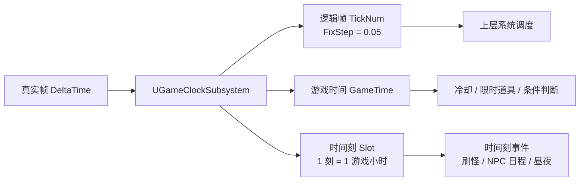
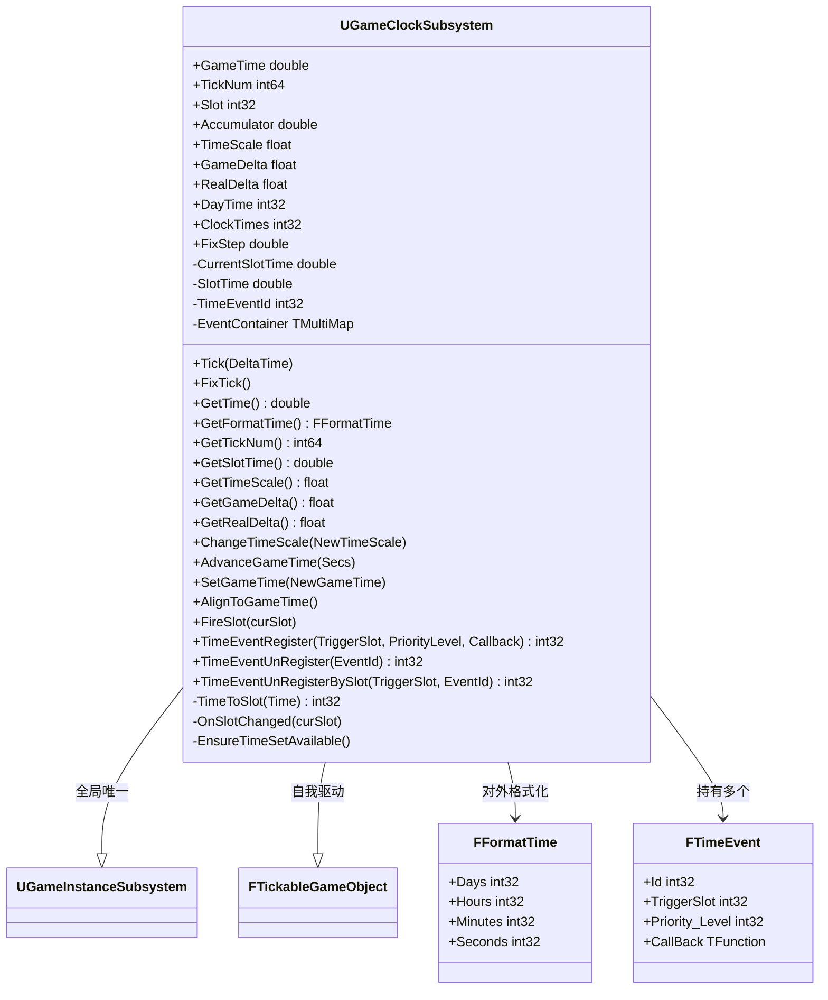
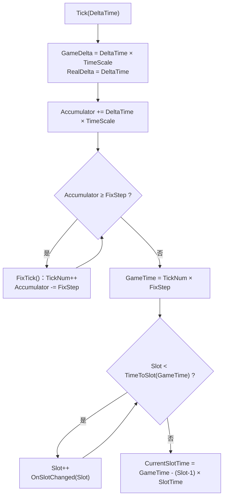
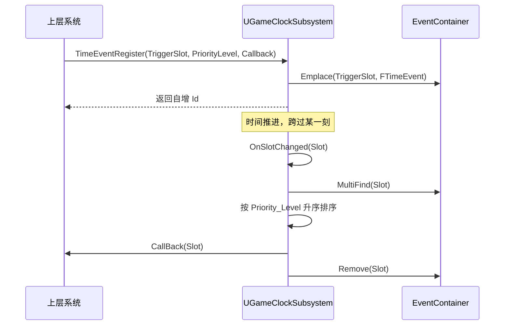
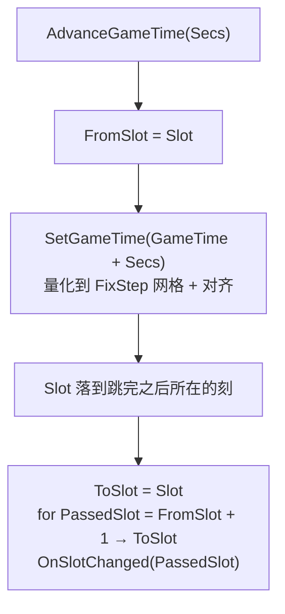

> **PS:** 本文拆解 TheDemiuge 的 L0 时间系统，代码位于 `Source/TheDemiugeUE5/Public|Private/Subsystem/clock/`。

## 系统设计目的

- 给整个游戏提供**唯一的时间真源**。冷却、限时道具、刷怪、昼夜、NPC 日程全部向这里取时间，任何系统都不允许自带计时器。
- 管理**游戏时间、逻辑步长、以天为单位的时间设置**。
- 支持**时间跳转**：睡觉、旅行、快进要能一次把时间推过去，而且跳过的这段时间里该发生的事件一件不漏。
- 支持**阈值事件的集中调度**：把「1 小时后刷怪」「8:00 NPC 上班」注册到时间轴上，到点统一触发。
- 时间轴本身要能被存档系统完整读写（阶段 2 接入）。

## 理论基底讲解

**时间是「可推进的累计量」，不是读系统时钟。**

真实时间只以增量形式（`DeltaTime`）进入系统，游戏时间由我们自己累加。这样存档、回档、加速、暂停、跳时间才能共用同一套逻辑。

**时效性数据存绝对时间戳，不存剩余时长。**

冷却记的是「结束时刻的游戏时间」，而不是「还剩 3 秒」——否则睡觉跳过 8 小时，冷却永远走不完。

**逻辑帧是唯一的计数源。**

游戏时间不独立累加，而是 $GameTime = TickNum \times FixStep$，时间只是逻辑帧的换算结果。两套计数各走各的，迟早会慢慢漂移。

**通知方式分三种。**

- 连续量（进度条）→ 上层每帧主动拉取
- 阈值跨越（冷却结束 / Buff 到期）→ 注册到时间刻，由时钟集中分发
- 控制状态（时速变化、暂停）→ 广播

## 系统架构设计

整个游戏的时间真源只有一个 `UGameClockSubsystem`：

- 它是 `UGameInstanceSubsystem`：**全局唯一、跨关卡存活**，不是挂在 Actor 上的组件。
- 同时实现 `FTickableGameObject` 自己驱动自己：`GetTickableGameObjectWorld()` 返回 `nullptr`（全局对象，不属于任何 World）、**游戏暂停时仍然 Tick**、编辑器里不 Tick。

### 三种时间表达

- **游戏时间 `GameTime`（秒）**：逻辑时间轴本体，恒等于 `TickNum × FixStep`。存档、条件判断、界面显示都取它。
- **逻辑帧 `TickNum`（帧）**：固定步长推出来的确定性计数单位。
- **时间刻 `Slot`（刻）**：粗粒度事件调度单位。一刻 = $DayTime / ClockTimes$ = 3600 秒 = 1 游戏小时。

`Slot` 从 **1** 起：第 n 刻覆盖 `[(n-1) × SlotTime, n × SlotTime)`，跨过一小时才进入第 2 刻。头文件里的 `ETimeCategory`（`TICK` / `TIME` / `FORMATTIME`）就是这三类查询的分类标注。

> **PS:** `DayTime` / `ClockTimes` 被标成「请不要动态更改这个值」是有原因的：它们是刻长的定义来源，改掉之后已经按旧刻注册的事件和当前 `Slot` 会集体对不上。所以刻长只在构造时算一次（`EnsureTimeSetAvailable()`），运行期只读。

### 两套步进：固定步长 + 时间刻

```txt
                 Tick(DeltaTime)
                       │
        ┌──────────────┴───────────────┐
        │                              │
 Accumulator += Δt × TimeScale      GameTime = TickNum × FixStep
        │                              │
 while (Acc ≥ FixStep)          while (Slot < TimeToSlot(GameTime))
     FixTick() → TickNum++          Slot++ → OnSlotChanged(Slot)
        │                              │
   逻辑帧：确定性推演              时间刻：粗粒度事件调度
```

- **固定步长（`FixStep = 0.05`）**：真实帧率是不稳定的，逻辑不能跟着帧率跑。累加器攒够一个步长才推进一次逻辑帧，逻辑帧数因此是确定的。
- **时间刻（`SlotTime = 3600`）**：秒级的事件没必要每帧去比，只有跨越刻的那一刻需要分发事件。



> **PS:** 事件的时间精度被刻长限制，需要更细的粒度就调 `ClockTimes`——比如按分钟切成 1440 刻，其余逻辑一行都不用改。

## 程序结构分析



`FFormatTime` 是纯展示用的结构（天 / 时 / 分 / 秒），`FTimeEvent` 是挂在时间刻上的事件记录，两者都是数值类，不含逻辑。

### Tick 流程



两个累加器各管一段：`Accumulator` 攒逻辑帧，`CurrentSlotTime` 已经不再自己累加，而是由 `GameTime` 反推——**时间刻的判断和后面要讲的时间对齐共用同一条规则**，两条路径不会算出两个 `Slot`。

### 时间刻事件：注册 → 到点 → 销毁



事件容器是 `TMultiMap<int32, FTimeEvent>`，key 是时间刻序号，同一刻允许挂多个事件。

```cpp
// 注册到指定时间刻：只能注册到「未来」的刻，失败返回 INDEX_NONE 并打警告
int32 TimeEventRegister(int32 TriggerSlot, int32 PriorityLevel,
                        const TFunction<void(int32)>& Callback);

// 注册到「目标时间之后进入的第一个时间刻」：上层不用自己算刻号
int32 TimeEventRegisterAtTime(double TargetGameTime, int32 PriorityLevel,
                              const TFunction<void(int32)>& Callback);

// 注销：整表扫一遍，或者只在对应的时间刻里小范围扫（省一点复杂度）
int32 TimeEventUnRegister(int32 EventId);
int32 TimeEventUnRegisterBySlot(int32 TriggerSlot, int32 EventId);

// 触发：取出该刻全部事件 → 排序 → 依次回调 → Remove(curSlot)
void FireSlot(int32 curSlot);
```

同一刻内挂多个事件时先按 `Priority_Level` 升序排一遍再执行（小值优先），顺序可预期，不依赖容器的遍历顺序。

注册有个硬规则：**只能注册到未来的刻**。时间只往前走，「正在触发的刻」和「已经过去的刻」永远等不到触发，所以系统直接拒绝并返回 `INDEX_NONE`——把「排不上」当场暴露出来，而不是静默吞掉。校验基准是 `FiringSlot`（当前正在触发哪一格），回调里往同一刻再注册会被拦住，往后面还没走到的刻注册则完全正常。

`TimeEventRegisterAtTime()` 就是照着这条规则包装给上层用的：延迟效果直接写 `TimeEventRegisterAtTime(GetTime() + 600, ...)`，刻号由系统按 `Ceil(TargetTime / SlotTime) + 1` 反推，拿到的正好是「目标时间之后进入的第一个刻」。代价是精度落在刻上——`SlotTime = 3600` 时，600 秒后的事件实际会在下一个整点触发。

> **PS:** 触发后整个 key 会被清空，所以事件是**一次性**语义：注册 → 到点触发 → 销毁。它刚好覆盖冷却、延迟效果、定时器这一大类需求。周期事件是另一种语义（容器还得记「触发了几次、下一次什么时候」），不硬塞进同一个容器里。

### 时间跳转与对齐

`AdvanceGameTime(Secs)` 是「跳过人生」：睡觉、旅行、快进都用它。



```cpp
const int32 FromSlot = Slot;
SetGameTime(GameTime + Secs);   // 内部量化 + 对齐，Slot 直接落到跳完之后所在的刻
const int32 ToSlot = Slot;      // 上界当场固定
for (int32 PassedSlot = FromSlot + 1; PassedSlot <= ToSlot; ++PassedSlot)
{
    OnSlotChanged(PassedSlot);
}
```

顺序不能反：**先落时间轴、后补事件**。反过来的话，量化误差（不足一个 `FixStep` 的零头被舍掉）可能把 `Slot` 推到一个没触发过的刻上，那一刻的事件就永远丢了。

`SetGameTime(NewGameTime)` 是直接写时间轴（读档、倒流、外部系统强改）。逻辑时间只能落在固定步长网格上，所以它先量化，再交给对齐：

```cpp
const int64 GridIndex = FMath::Max<int64>(FMath::RoundToInt64(NewGameTime / FixStep), 0);
GameTime = GridIndex * FixStep;
AlignToGameTime();
```

> **PS:** 量化用的是四舍五入（半进位），所以请求时间落在刻边界前 0.025 秒以内时会被顶到边界上——`AdvanceGameTime(7199.99)` 和 `AdvanceGameTime(7200)` 是同一个结果。想要「绝不比请求多跳」，把 `RoundToInt64` 换成 `FloorToInt64` 就行。

`AlignToGameTime()` 是唯一的「派生状态出口」，四个派生量全部由 `GameTime` 反推：

```cpp
// FixStep = 0.05 在二进制里并不精确，但直接相除 + 四舍五入就够准
TickNum         = FMath::RoundToInt64(GameTime / FixStep);
Accumulator     = GameTime - TickNum * FixStep;

Slot            = TimeToSlot(GameTime);                 // 所在刻，1 起
CurrentSlotTime = GameTime - (Slot - 1) * SlotTime;
```

思路是「谁改时间，谁负责把派生状态一起修正」：时间轴可以有多个入口（自然 Tick、Advance、Set），但派生状态只能有一个出口。

> **PS:** `Slot` 的反推公式是 `Floor(GameTime / SlotTime) + 1`（`TimeToSlot`），起点是 1 而不是 0——第 1 刻覆盖 `[0, SlotTime)`。这一点必须和 Tick 路径对齐，用 `Ceil` 会整体差一格；而 Tick 用的是「跨过边界后 `Slot++`」，两者本来就是一回事，所以干脆抽成同一个函数。

### 蓝图接口

子系统对外的接口全部是 `UFUNCTION(BlueprintCallable)`，蓝图侧不需要知道内部结构：

- `GetTime()` / `GetFormatTime()`：当前游戏时间，秒 / 天时分秒
- `GetTickNum()`：当前逻辑帧数
- `GetSlotTime()` / `Slot`：一刻的时长 / 当前时间刻
- `GetTimeScale()` / `ChangeTimeScale()`：读取 / 修改时速，改动会广播 `OnTimeScaleChanged`
- `GetGameDelta()` / `GetRealDelta()`：游戏帧时间 / 真实帧时间
- `AdvanceGameTime()` / `SetGameTime()` / `AlignToGameTime()`：跨刻推进 / 直接写时间轴 / 对齐派生状态
- `FireSlot()`：手动触发某一刻
- `TimeEventRegister()` / `TimeEventUnRegister()` / `TimeEventUnRegisterBySlot()`：注册 / 注销时间刻事件（C++ 侧）

`ChangeTimeScale` 带幂等判断：新旧值相同直接 `return`，避免上层监听者收到无意义的重复通知。

## 附录

[GameClockSubsystem.h](https://github.com/rechenz/TheDemiugeUE5/blob/main/Source/TheDemiugeUE5/Public/Subsystem/clock/GameClockSubsystem.h)

[GameClockSubsystem.cpp](https://github.com/rechenz/TheDemiugeUE5/blob/main/Source/TheDemiugeUE5/Private/Subsystem/clock/GameClockSubsystem.cpp)
